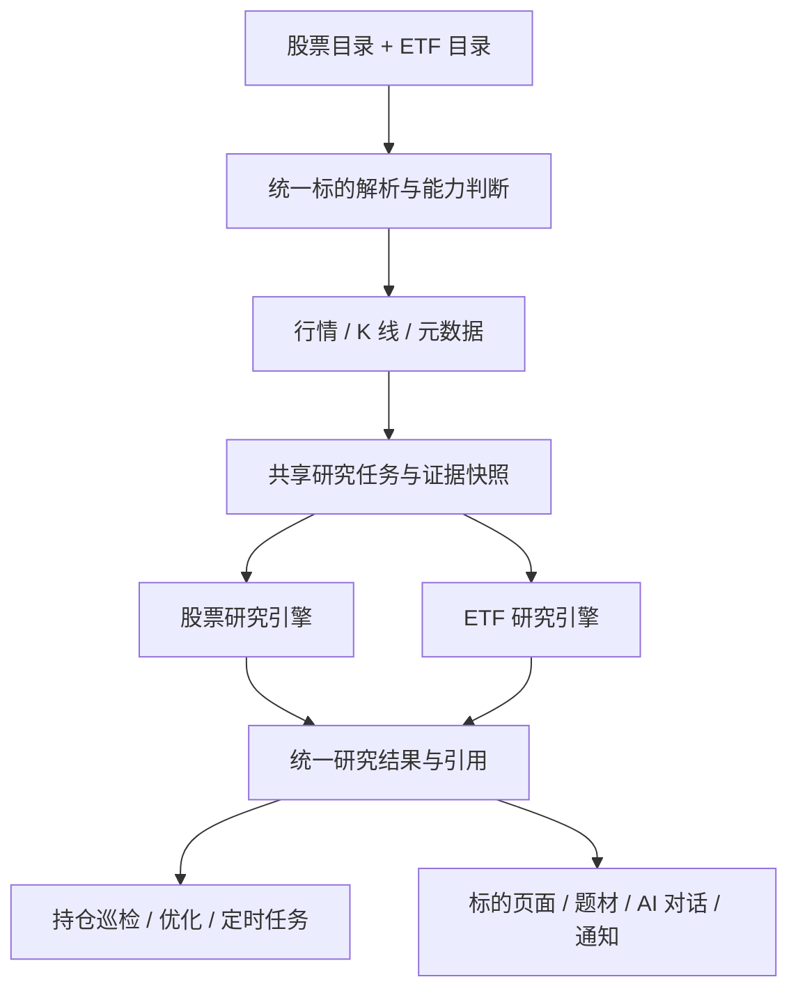

# ETF 全链路支持方案

日期：2026-10-10。目标：开源版 `oss-main` / `upstream`。状态：全链路后续规划；单标的 ETF AI 分析、公告／持仓／盘口证据及混合持仓巡检已接入。

2026-10-11 优先级更新：用户指定先让现有「个股 AI 分析」支持 ETF。当前首期范围、分析方法与实施顺序以[ETF AI 分析专项方案](etf-ai-analysis-design.md)为准。本文保留全系统后续路线；下文完整 P0–P3 顺序不再作为单标的研究上线的前置要求。

2026-10-12 实施更新：混合持仓支持 ETF 身份确认、报告复用、披露持仓重叠与独立资产评价；ETF 优化仍冻结原仓位，公开行情不代替交易规则、停复牌和申赎状态，自动 ETF 候选尚未开放。各项实际边界见专项方案文首。

## 1. 目标与范围

让 ETF 成为系统正式支持的标的：能搜索、看行情与 K 线、做专属研究、加入持仓、参与巡检和优化，也能从题材、复盘和 AI 对话进入同一套流程。

用户已确认首轮范围为**沪深上市的场内 ETF 全品类**，覆盖股票、债券、商品、跨境和货币类。跨境是投资范围，股票 / 债券 / 商品 / 货币是底层资产类别，两者分别建模。例如，跨境股票 ETF 同时具有股票风险与跨境属性。港美市场直接上市的 ETF、场外基金、ETF 联接基金、LOF、REITs 暂不纳入本轮。

全品类纳入目录与能力识别；不同品类依据真实数据开放研究和优化能力。货币 ETF 的收益分配和报价口径需要专门验证，不能直接用股票价格涨幅评价收益。尚未通过验证的能力显示具体缺口，不冒充已支持。

交付分两层：

- **基础可用**：身份准确、可查可看、可保存持仓，价格和估值口径正确。
- **全链路完成**：再完成 ETF 研究、混合持仓巡检、优化、题材关联、AI 入口、通知和历史兼容。基础行情上线不等于整套系统已经支持 ETF。

本轮保持研究工作台定位，不增加券商下单、一级市场申赎或自动交易。

## 2. 当前代码核查

以下是方案制定时的代码检查结果；现有实现与外部接口验收以专项方案的当前交付章节为准。

| 模块 | 现状与问题 | 改造方向 |
| --- | --- | --- |
| 标的解析 | [`foundation/symbol.go`](../backend/internal/foundation/symbol.go) 按 A 股首位推断市场，裸代码 `510300` 会变成 `510300.SZ`；显式 `.SH` 可以通过语法解析，但没有资产类型校验 | 分离代码格式化、目录解析、业务资格校验 |
| 搜索目录 | [`stock_catalog.go`](../backend/internal/providers/eastmoney/stock_catalog.go) 只查询 A 股板块；[`stock_directory.go`](../backend/internal/httpapi/stock_directory.go) 只返回代码与名称 | 独立 ETF 目录，统一搜索视图，保留股票池的股票语义 |
| 行情 / K 线 | [`foundation/types.go`](../backend/internal/foundation/types.go) 已有可复用结构；东财 K 线固定 `fqt=1`，新浪作为回退；未显式声明复权与成交量单位 | 增加价格口径、单位、精度、可用性与 ETF 数据适配 |
| 图表 / 价格锚点 | [`KLineChart.tsx`](../frontend/src/components/KLineChart.tsx) 多处价格固定两位；[`research_snapshot.go`](../backend/internal/stockanalysis/research_snapshot.go) 锚点使用 `round2` | ETF 精度必须贯穿展示、计算、报告和条件验证 |
| 单标的研究 | [`stock_analysis.go`](../backend/internal/httpapi/stock_analysis.go) 采集主营、财务、涨停与题材；[`stockanalysis/engine.go`](../backend/internal/stockanalysis/engine.go) 默认执行股票画像与评分 | 按资产类型选择证据与研究引擎 |
| 比较基准 | [`stockanalysis/decision.go`](../backend/internal/stockanalysis/decision.go) 根据上市板块选择股票基准 | ETF 优先使用真实跟踪指数 / 业绩基准 |
| 持仓 | [`PortfolioSetupForm.tsx`](../frontend/src/components/PortfolioSetupForm.tsx) 强依赖股票目录；[`portfolio-draft.ts`](../frontend/src/lib/portfolio-draft.ts) 未存资产类型 | 股票、ETF 共用持仓编辑与估值，保留类型和规则 |
| 巡检与复用 | [`portfolio_research.go`](../backend/internal/httpapi/portfolio_research.go) 直接调用股票研究；组合结果嵌入 `stockanalysis.Analysis` | 统一研究引用，增加 ETF 事实与穿透暴露 |
| 优化 | [`portfolio_optimization.go`](../backend/internal/httpapi/portfolio_optimization.go) 从行业和股票目录筛选；[`constraints.go`](../backend/internal/portfoliooptimization/constraints.go) 使用股票涨跌幅阈值和 T+1 描述 | ETF 候选筛选、资产范围约束、交易规则和独立复评 |
| AI 入口 | 页面预填上下文和仓库内个股 Skill 以股票为对象；Hermes / Codex 已共用业务服务 | 给两种运行时提供一致的资产类型、证据与 ETF 分析指引 |

现有 [`backtesting-design.md`](backtesting-design.md) 是独立方案，完整回测平台尚不能当作现成能力。本方案与其共用标的、规则和价格口径契约，不将实现回测平台塞入 ETF 支持的前置工作。

## 3. 产品体验

| 入口 | ETF 支持后的行为 |
| --- | --- |
| 搜索 | 支持代码、名称和别名；可筛选「全部 / 股票 / ETF」，结果标识交易所、ETF 类别、基金管理人和跟踪指数；同指数多只 ETF 独立呈现 |
| 行情总览 | 增加 ETF 分页，按宽基、行业主题、债券、商品、跨境、货币等维度筛选；先展示涨跌、成交额、趋势，规模、份额变化与折溢价随可用数据补齐 |
| 标的分析 | 「个股分析」入口调整为「标的分析」，选中 ETF 后呈现 ETF 概况、跟踪标的、量价、产品质量、折溢价与风险；隐藏不适用的公司财务和连板模块 |
| 持仓 | 可混合添加股票和 ETF；显示「持仓标的」，数量按股票显示股、ETF 显示份；统一保留多方案、成本、盈亏和定时巡检 |
| 持仓报告 | 同时解释直接持仓与底层暴露，识别同指数多 ETF、行业重叠、股票与 ETF 重仓股重叠，以及跨境 / 币种风险 |
| 持仓优化 | 可选择候选范围「股票 / ETF / 股票与 ETF」；给出明确的替换依据、资金来源、约束和 ETF 入场条件 |
| 题材雷达 | 题材详情增加「相关 ETF」，每条关联显示依据；点击可研究或添加持仓 |
| 复盘 / AI / 通知 | ETF 引用可以跳转；报告与通知保留类型、精度、证据日期；从报告继续对话时传递 ETF 上下文 |
| 超短连板 | 股票梯队继续统计股票；ETF 可作为题材观察入口，不混入连板高度、涨停家数或股票情绪评分 |

用户示例：搜索 `510300` → 识别沪市 ETF → 查看跟踪标的与行情 → 发起 ETF 研究 → 加入已有股票组合 → 巡检识别重叠暴露 → 在允许的候选范围内优化 → 保存方案并继续定时巡检。

## 4. 标的与数据架构

### 4.1 统一身份，保留现有代码格式

新增 `Instrument`，建议放在 `foundation/instrument.go`；股票与 ETF 的规范代码继续使用 `510300.SH` 一类格式，避免整体改写持仓、URL 和历史记录。

| 字段组 | 建议内容 |
| --- | --- |
| 身份 | `symbol`、`code`、`exchange`、`instrument_type: stock / etf`、`name`、`aliases` |
| ETF 分类 | `underlying_asset_class`、`strategy_type`、`cross_border`、投资地区；不凭简称推断资产属性 |
| 报价信息 | `quote_currency`、`price_precision`、`quantity_unit`、成交量标准单位 |
| 生命周期 | 成立 / 上市 / 终止日期、交易状态、目录来源、版本、生效时间 |
| 交易规则引用 | `trading_rule_id`，关联带来源和生效区间的规则 |
| 能力 | 行情、K 线、档案、净值、IOPV、持仓、研究、优化分别记录状态与原因 |

跟踪指数用独立的 `BenchmarkRef` 表示，带 `kind`、来源与来源代码。指数代码不能送入股票 / ETF 裸代码推断，避免把指数与股票、ETF 同名代码混淆。

解析顺序：显式交易所格式 → 查询目录核实身份；裸代码 / 名称 → 目录精确匹配 → 别名匹配；多个结果让用户选择。未知代码返回未识别，不默认归为股票或深市。既有内部指数调用先补齐明确身份，不能在改造公共解析函数时破坏指数行情。

ETF 类型必须来自可信目录或经过验证的产品档案。代码前缀仅可辅助市场格式化，不能将所有 `5xxxxx`、`1xxxxx` 认作 ETF，也不能将 LOF、联接基金混入。

### 4.2 能力状态与数据缺失

至少区分 `available`、`unsupported`、`unavailable`、`stale`：分别表示可用、不适用 / 尚不支持、暂时获取失败、已有数据过期。可空数值配合来源和日期；缺失净值不等于净值为零，缺失持仓不等于无重叠。

能力由产品类型和服务端已验证的数据适配共同决定，不能只接受前端传入的 `instrument_type` 或能力标记。

### 4.3 ETF 专属数据

新增 ETF 专属模型，不把基金档案塞进 `StockFundamentals`：

- `ETFProfile`：管理人、基金类型、跟踪指数 / 基准、复制方式、费率、生效日期、基金规模、规模日期、上市状态。
- `ETFNetValue`：单位净值、估值日期、发布日期、币种、分红 / 份额调整口径。
- `ETFIndicativeValue`：IOPV、更新时间、币种、估值机制与可用性。
- `ETFHoldings`：底层标的、权重、报告期、披露时间、覆盖比例、是否完整；区分实际披露持仓、指数成分与申赎清单。
- `ETFShareHistory`：基金份额、单位、对应日期及拆分调整信息。
- `ETFTrackingMetrics`：比较基准、样本区间、频率、收益口径、跟踪差异 / 误差、计算方法。

每组数据有独立时点和来源，不能因为刚抓取就把季度持仓标成最新实时持仓。

### 4.4 Provider 与数据源验证

复用当前 Go Provider 注入方式，新增目录、档案、净值、持仓与规则的接口；仍使用本地优先缓存。应用基本能力不依赖开发者机器上额外安装的 CLI。

| 数据 | 优先验证的来源 / 接入方式 | 验证重点 |
| --- | --- | --- |
| ETF 目录与基础截面 | 东财场内 ETF 目录候选接口；交易所 / 管理人公开资料核对 | 分页完整性、类型识别、终止上市、同名产品、覆盖数量 |
| 行情与 K 线 | 验证现有新浪 / 东财链路，必要时增加腾讯等适配 | 精度、成交量单位、成交额、复权、停牌、空结果、时间戳 |
| 档案、费率、规模、份额 | 基金数据接口候选源与管理人披露 | 规模与份额日期、费用口径、变更生效日 |
| 净值、IOPV、折溢价 | 基金净值来源与交易所 / 行情源提供的 IOPV | 时点、币种、跨境错时、是否真正支持盘中 IOPV |
| 持仓与基准 | 定期报告、指数编制方与基金披露 | 报告期和披露日期、前十大 / 完整持仓、权重单位 |
| 交易规则与状态 | 交易所现行规则与产品公告 | 每只产品适用规则、例外、生效日期、暂停申赎与暂停交易的区别 |

以上是接入候选，不能在 P0 验证前承诺全部字段可得。P0 产出「来源—品类—字段—可用性」矩阵、脱敏样本与单位说明。若任一品类缺少必需字段，明确该品类暂限于哪些能力。

目录与档案分层缓存；失败可返回最近成功快照并标记过期。不同 ETF、基准、周期与复权方式使用不同缓存键。行情回退必须保持同一价格与单位口径，不能静默拼接不同复权序列。

## 5. ETF 计算口径

### 5.1 价格、份额与交易规则

- 价格展示按标的元数据；很多场内 ETF 需要三位小数，但不将三位写成所有 ETF 的固定规则。金额、比例、净值与成本价使用各自精度。
- 价格锚点、条件阈值、导出和通知保留有效精度；可交易价格按已验证的最小变动单位对齐。成本均价不强制截成报价档位。
- 持仓估值沿用当前按总资产、仓位和成本推算数量的逻辑，明确为估算，不因新增 ETF 重新按整手取整历史持仓。实际可交易数量建议另按最小买入单位、卖出规则计算。
- 规则模型包含最小价格变动、买入单位、卖出数量规则、回转交易限制、涨跌幅限制、日历与有效日期。股票型、债券、商品、跨境 ETF 不统一硬编码为 T+0 或 T+1。
- ETF 二级市场费用不沿用股票印花税配置；未来测算 / 回测使用独立且有版本的费用规则。
- 上市市场决定场内交易时段；底层市场日历与时区决定参考估值的新鲜度。人民币报价不代表没有汇率风险。

### 5.2 净值、折溢价和资金变化

实时参考折溢价使用同币种、时点可比且有效的 IOPV：`(市场价格 / IOPV - 1) × 100%`，明确 IOPV 也是参考估值。

对上一公布日单位净值的偏离单独标注净值日期，不称为实时折溢价。跨境 ETF 底层市场未开盘、节假日不同或净值滞后时，显式展示错时限制；不能凭旧净值判定存在可成交套利。

份额变化用于描述申赎规模变化；如用份额变化乘净值估算资金，必须标为估算并处理拆分。成交额、行情源的主力资金口径、一级市场净申赎不能混称「ETF 净流入」。

### 5.3 K 线、收益与基准

报价、成本和当前估值使用实际市场价格。历史趋势、分红复权、净值收益与总回报分别声明口径，不用前复权价格直接充当历史成交价。

跟踪质量优先使用基金净值收益与对应基准收益的可比序列；市场价格相对指数的偏离可另作交易指标。必须对齐日期、币种、分红和收益口径，不能把行情涨幅之差直接称为跟踪误差。

货币 ETF 需要识别收益分配 / 累积方式；仅有市场价格时可以给出价格估值，但不能包装为含收益分配的完整投资回报。若缺少可比基准或收益数据，对应指标返回缺失。

## 6. 研究体系改造

### 6.1 共用任务，区分研究引擎

建议新增 `instrumentresearch` 作为统一编排与结果契约，新增 `etfanalysis` 负责 ETF 证据和规则。现有股票引擎保留，通过适配器接入；逐步抽出已实现的队列、取消、检查点、引用、复用和通知机制，不复制第二套任务生命周期。

统一结果采用带类型的结构：公共头部包含标的身份、行情、研究目的、周期、模型配置、证据时点、状态、来源和报告引用；正文为 `stock` 或 `etf`。ETF 不伪造股票画像、公司财务或股票评分来满足旧结构。

复用现有「量化速览 / 快速 / 标准 / 深度」以及「观察 / 新开仓 / 持仓」流程。ETF 深度补证由后端映射到允许的 ETF 数据源；模型工具策略沿用当前受控研究方式。

### 6.2 ETF 研究内容

| 维度 | 应回答的问题 |
| --- | --- |
| 投资对象 | 跟踪什么，指数如何选样与加权，实际获得哪些市场与行业暴露？ |
| 市场与趋势 | 标的市场和基金价格如何变化，波动与回撤是否适合所选周期？ |
| 产品质量 | 流动性、买卖价差、规模、费率、跟踪表现如何，同基准产品有何差异？ |
| 折溢价与执行 | 当前参考估值是否有效，是否存在高溢价、成交不足或状态限制？ |
| 类型特有风险 | 股票行业集中；债券利率 / 久期 / 信用；商品现货或期货敞口与展期；跨境错时 / 汇率 / 额度；货币收益口径等 |
| 组合用途 | 在当前组合中提供什么暴露，是否与其他持仓重复，替换代价是什么？ |

缺少久期、信用结构等信息时说明未获取，不能由名称推定。分红率、费率和管理人信息必须有日期与来源。

禁止给 ETF 输出「公司营收增长」「ROE 较差」「连板龙头」等结论；持仓公司或跟踪指数的估值必须标明对象，不能成为 ETF 自身 PE / ROE。ETF 规则评分单独版本化，不与股票总分直接排在同一榜单。

### 6.3 报告复用与恢复

股票与 ETF 的复用至少校验规范标的、类型、研究模板 / 算法版本、级别、目的 / 周期的兼容性、有效时点与快照版本。ETF 身份、基准、产品规则变化后，不能继续复用旧模板结果。

维持现有报告可查；ETF 复用窗口可沿用 24 小时作为上限，但不能以报告年龄覆盖行情、净值、停牌与产品状态的新鲜度要求。组合估值和执行资格使用新快照重新计算。恢复索引、共享任务去重和检查点必须携带资产类型与模板版本。

## 7. 持仓巡检与优化

### 7.1 巡检

保留多方案、最多 10 个持仓标的、仓位与现金约束、研究复用、定时巡检和明日预期。改造 `HoldingResult`、组合事实与引用校验，使组合能同时读取两种研究结果。

保留四维评价框架，但混合组合使用新评分版本与适配后的依据。股票的经营质量替换为相应资产的持有逻辑；基金产品集中度与底层资产集中度分别评价。不能把单只宽基 ETF 等同于单一公司集中，也不能因为它叫 ETF 就自动认定充分分散。

穿透示例：ETF 占总资产 20%，已披露的某股票权重为 ETF 的 8%，则贡献 1.6% 的已知间接暴露；再加上直接持有该股票的仓位。仅有前十大持仓时展示已知部分与覆盖率，其余为未知，不能重新归一化前十大充当全部持仓。指数成分只能作为标明来源的代理暴露。

历史相关性按日期与收益口径对齐，跨境错时单列限制；数据不足时返回缺失。货币 / 债券 ETF 仍是持仓资产，不自动归入现金。现金和总仓位本身不加减分，沿用现有产品原则；股票专属的事实字段保留旧语义，混合组合新增通用字段。

### 7.2 优化

增加 `allowed_instrument_types`，限制可新增标的的范围。旧方案默认仍为股票；新建纯 ETF 方案默认 ETF；新建混合方案默认两者，界面可见、可修改。原有持仓即使不在新增候选范围内仍可评估与减持。

ETF 走独立候选筛选：真实目录 → 状态、数据与流动性资格 → 资产 / 指数分组 → 趋势与持有周期适配 → 同基准产品比较 → 有限候选研究。不能沿用「行业成分股初启」作为所有 ETF 的入口。

继承现有现金不变、累计替换比例、最多新增 2 个、最多 10 个持仓等边界；增加可选的资产类别比例边界，防止优化过程在用户没有选择时大幅改换资产类别。硬性产品权重约束与风险评分分开；如以后调整宽基 ETF 权重上限，使用明确的新配置版本，不静默放宽旧方案。

原组合与目标组合使用同次证据复评。比较的是组合目的、预期暴露、风险、成本和执行条件，不直接比较股票规则分与 ETF 规则分。程序校验候选资格、金额 / 权重和交易规则；信息不足允许无调整或条件性方案。

## 8. API、前端与历史兼容

建议接口，正式字段在 P0 数据验证后冻结：

| 接口 | 用途 |
| --- | --- |
| `GET /api/v1/instruments?types=stock,etf&query=...` | 统一搜索，分页并支持类型筛选 |
| `GET /api/v1/instruments/{symbol}` | 身份、规则、能力及基础档案 |
| `GET /api/v1/etfs?category=...` | ETF 行情列表和筛选 |
| `GET /api/v1/etfs/{symbol}/profile` | ETF 档案与基准 |
| `GET /api/v1/etfs/{symbol}/nav` | 净值与参考估值，明确日期 |
| `GET /api/v1/etfs/{symbol}/holdings` | 持仓及覆盖率 |
| `/api/v1/instruments/research` 及对应任务子路由 | 类型分派后的统一研究任务，覆盖创建、列表、详情、取消、恢复、快照与验证 |

现有 `quotes/realtime`、`quotes/kline`、批量 K 线及行情 WebSocket 继续复用，响应增加标的 / 价格口径元数据，逐标的处理不支持和失败。旧 `stocks/directory` 与股票研究路由保持股票语义和响应形状，兼容旧客户端；不会给旧股票接口偷偷塞 ETF。

前端新增共享搜索组件和价格 / 数量格式化函数；分析页面按结果类型渲染。更新 `App.tsx`、行情工作区、研究页、持仓表单、优化报告、复盘跳转及通知文案。技术类型名逐步迁移，不为了名称统一一次性重命名所有股票模块。

存储采用增量迁移：

1. 新增持久化标的 / ETF 元数据缓存，可独立为 `instruments.db`，接入现有备份与恢复清单。
2. 持仓 localStorage、研究任务 JSON、SQLite 索引、优化与定时任务快照增加 schema / 资产类型版本；写入前校验，迁移可重复执行。
3. 老数据优先用目录验证类型；无法验证的记录保留原数据并标记待解析。不能把缺类型的所有历史记录一律当股票，也不能静默把旧 `510300.SZ` 改成另一个标的。
4. 历史报告按保存时版本展示，不重新计算改写；旧股票报告不可作为 ETF 成功研究复用。旧暂停任务若无法兼容，仍可查看并提示重新运行。
5. 旧应用不能误读新版 ETF 持仓；保留原版本备份，明确新版数据的最低读取版本，避免降级运行覆盖新版状态。

## 9. 题材、复盘与 AI

题材关联依次使用真实跟踪指数、基金投资范围、披露持仓与经过维护的规则。保存关联依据、来源、更新时间与关联强度；基金名称关键词只用于候选检索。ETF 是投资工具，不被当作其跟踪指数本身，也不进入股票成分广度统计。

复盘中的 ETF 观点继续作为作者观点保存；将标的链接解析到 ETF，同时保留原文。原有 A 股情绪指标保持统计范围，ETF 行情独立呈现。

增加 ETF 研究 Skill，并更新股票 / 市场 Skill 的适用范围与路由说明；Hermes、Codex 使用相同后端契约。UI 预填、报告绑定对话、研究补证与已配置的数据工具均带资产类型和能力信息。不得只安装一个 Skill 就视为完成了后端 ETF 数据接入。Skill 打包与双运行时投影纳入发行检查。

## 10. 实施顺序与完成门槛

| 阶段 | 主要工作 | 完成门槛 |
| --- | --- | --- |
| P0：数据与契约验证 | 每类选择代表产品；验证目录、行情、K 线、档案、规则、净值与持仓；确定必要 / 可选字段和能力矩阵 | 确认每类能承诺的能力，保存单位和时点样本，明确回退限制；未验证项不能算通过 |
| P1：基础贯通 | 标的身份、ETF 目录、统一搜索、行情页、图表精度、持仓添加与估值、缓存迁移 | 沪深 ETF 可搜索、查看、保存与恢复；股票流程不回退；尚未实现的 ETF 研究明确显示状态 |
| P2：研究与巡检 | 共享任务契约、ETF 专属引擎、四级研究、混合持仓事实、穿透、定时任务、明日预期与通知 | 股票、ETF、混合组合均完成研究和巡检；缺失数据与未知暴露正确呈现；报告复用 / 恢复按类型隔离 |
| P3：全链路交付 | ETF / 混合候选优化、题材关联、复盘链接、AI 入口和 Skill、备份恢复、产品与 API 文档 | 完整用户路径跑通，所有纳入范围品类的能力矩阵逐项验收，才能称全链路支持 |

P0 → P1 → P2 → P3 是依赖顺序。首个实现切片建议用 `510300.SH` 与 `159915.SZ` 验证两个市场的基础链路，但其余品类仍保留在总体目标中，不能以这两只跑通代替全品类完成。精确工期在 P0 后估算，主要不确定性是数据覆盖与研究 / 组合契约迁移。

## 11. 验收与测试

| 场景 | 必须观察到的结果 |
| --- | --- |
| 身份与回归 | 裸代码 `510300` 正确解析；`159915.SZ` 正常；同名 ETF 可区分；A 股沪深北与已有指数查询不回退；LOF / 联接基金不被归类为 ETF |
| 价格精度 | `1.234 → 1.235` 在行情、图表、成本、锚点、报告、条件验证和通知中均不丢失；资金不因展示舍入参与错误计算 |
| 数据源与回退 | 目录分页、源缺字段、空 K 线、超时、单位变化、过期与断网有明确状态；禁止不同复权数据混接 |
| ETF 研究 | 每个品类至少一组固定证据样本；不出现公司营收 / ROE / 连板评分；货币 ETF 不以价格不变断言零收益 |
| 折溢价与日期 | 旧 NAV、跨境休市、IOPV 过期、币种不一致不会输出伪实时折溢价；缺少指标显示原因 |
| 混合持仓 | 股票 + 宽基 ETF + 行业 ETF + 债券 / 商品 ETF 正确估值；重复底层暴露能识别，前十大持仓缺口不当作零 |
| 优化 | 按允许类型生成候选，遵守资产类别与现金等约束；ETF 不用股票涨停阈值判断；不同基准产品不冒充同指数替代品 |
| 历史与任务 | 老持仓迁移、旧报告查看、定时任务重启、取消 / 恢复、报告复用、新版备份恢复均不丢数据；类型冲突保留并可解释 |
| 产品入口 | 搜索 → 行情 → 研究 → 加入持仓 → 巡检 → 优化 → 保存方案 → 定时巡检 / 通知 → AI 追问全程可用 |

实现时先做 Provider 固定样本测试、解析 / 精度 / 规则与报告契约测试，再做持仓和迁移的集成测试及前端关键路径验证。联网测试沿用现有显式启用方式，记录交易日期和能力覆盖；单次公开接口成功不能证明全部 ETF 已覆盖。

本文件保留全链路规划，不能据此把尚未实现的阶段当作已交付；本次没有提交或推送代码。

2026-10-12：ETF AI 分析新增投资方向分类、对应指数/行业技术证据和方向新闻检索，采用“方向优先、产品随后”的流程。完整规则与数据边界见 `etf-ai-analysis-design.md` 的“投资方向优先的研究流程”。新报告版本为 `etf-research-v4`，已保存的旧报告需重新分析以取得新增证据。
